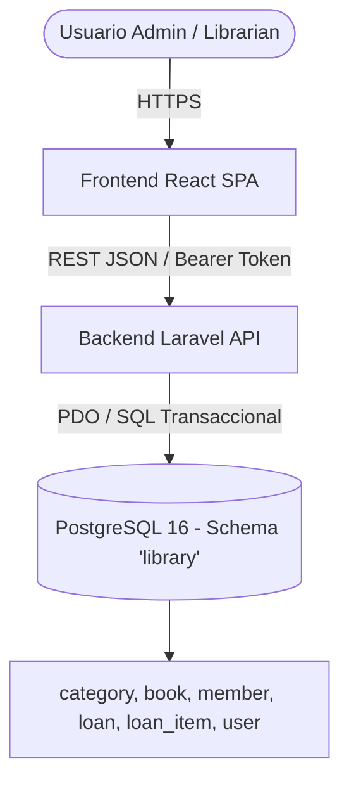

# Arquitectura del Sistema — Manager Library (Laravel + React)

## 1. Visión Panorámica

El sistema opera bajo un esquema desacoplado cliente-servidor:
- **Frontend SPA (React):** Interfaz moderna y reactiva que consume la API REST mediante JSON y autenticación por tokens Bearer.
- **Backend API (Laravel):** Capa de servicios RESTful que orquesta la lógica de negocio, reglas de concurrencia e integridad transaccional sobre PostgreSQL.
- **Base de Datos:** PostgreSQL 16 con esquema `library`, tipos nativos UUID v4 y marcas de tiempo en UTC (`timestamptz`).



---

## 2. Estructura del Backend (Laravel)

```
test-manager-library-3145555-api/
├── app/
│   ├── Domain/                      # Lógica de dominio pura
│   │   ├── Services/                # LoanService, BookService, AuthService
│   │   └── ValueObjects/            # Isbn, DateRange, CopyCounter
│   ├── Http/
│   │   ├── Controllers/             # Controladores delgados que delegan a servicios
│   │   │   ├── AuthController.php
│   │   │   ├── BookController.php
│   │   │   ├── CategoryController.php
│   │   │   ├── LoanController.php
│   │   │   ├── MemberController.php
│   │   │   ├── ReportController.php
│   │   │   └── UserController.php
│   │   ├── Middleware/              # Autenticación y control de roles (admin/librarian)
│   │   ├── Requests/                # Validación de entrada (FormRequests)
│   │   └── Resources/               # Transformadores de respuesta JSON según contrato
│   ├── Models/                      # Modelos Eloquent mapeados a schema 'library'
│   │   ├── Category.php             # protected $table = 'library.category'
│   │   ├── Book.php                 # protected $table = 'library.book'
│   │   ├── Member.php               # protected $table = 'library.member'
│   │   ├── Loan.php                 # protected $table = 'library.loan'
│   │   ├── LoanItem.php             # protected $table = 'library.loan_item'
│   │   └── User.php                 # protected $table = 'library.user'
│   └── Exceptions/
│       └── Handler.php              # Formateador central de excepciones a JSON canónico
├── database/
│   ├── migrations/                  # Migraciones DDL con esquema 'library'
│   └── seeders/                     # Seeder de las 5 categorías semilla
└── routes/
    └── api.php                      # Rutas prefijadas con /api/v1
```

---

## 3. Estructura del Frontend (React)

```
test-manager-library-3145555-app/
├── src/
│   ├── assets/                      # Estilos, íconos y logos
│   ├── components/                  # Componentes reutilizables
│   │   ├── Navbar.jsx
│   │   ├── Sidebar.jsx
│   │   ├── Modal.jsx
│   │   ├── Badge.jsx
│   │   └── Alert.jsx
│   ├── context/                     # Contexto de autenticación y usuario
│   │   └── AuthContext.jsx
│   ├── pages/                       # Vistas principales del sistema
│   │   ├── LoginPage.jsx
│   │   ├── BooksPage.jsx
│   │   ├── LoansPage.jsx
│   │   ├── MembersPage.jsx
│   │   ├── OverduePage.jsx
│   │   └── ReportsPage.jsx
│   ├── services/                    # Cliente HTTP Axios / Fetch
│   │   └── api.js                   # Interceptores para Bearer token y errores
│   ├── App.jsx                      # Enrutamiento protegido por rol
│   └── main.jsx
```

---

## 4. Estrategia de Concurrencia y Transaccionalidad

- **Préstamo de ejemplares:** Cada operación de préstamo envuelve la reducción de `available_copies` y la creación de `loan_item` en una transacción única (`DB::transaction`).
- **Blindaje del motor:** La restricción `ck_book_available_range` (`0 <= available_copies <= total_copies`) asegura que ante dos préstamos simultáneos del último ejemplar, el motor aborte la segunda transacción levantando un error que la API traduce a `409 BOOK_NOT_AVAILABLE`.
